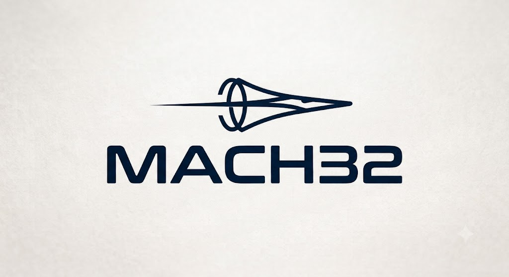

# MACH32 - STM32 Baremetal Drivers

A learning-focused bare-metal driver pack for the STM32F446RE.

Included drivers:

- RCC, GPIO, SysTick, NVIC, and EXTI.
- Polling USART, SPI, and I2C.
- Timers, PWM, ADC, and DMA.
- Internal Flash, CRC32, and the independent watchdog.
- Polling bxCAN.

The code uses ST and Arm CMSIS register definitions. Hardware-dependent behavior
is not verified yet.
